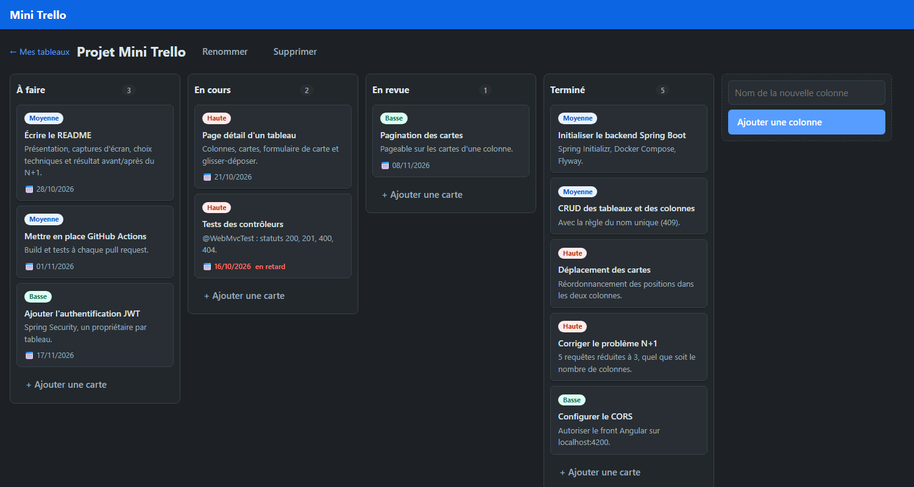
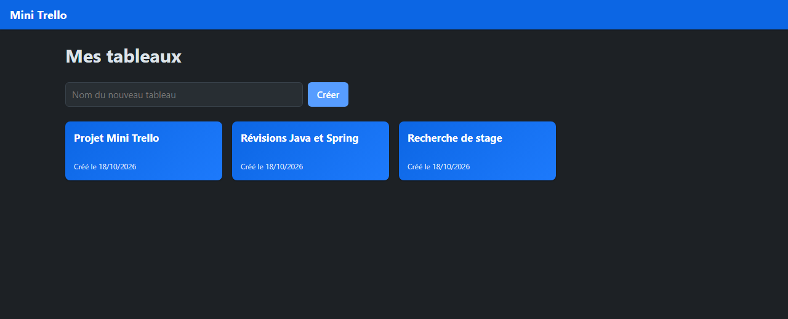

# Mini Trello

Application de gestion de tâches en tableaux, colonnes et cartes, inspirée de Trello.
Projet d'entraînement sur la stack **Spring Boot / PostgreSQL / Angular**, avec une API REST structurée, des règles métier testées et un front qui permet de déplacer les cartes par glisser-déposer.





## Fonctionnalités

- **Tableaux** : créer, lister, renommer, supprimer.
- **Colonnes** : ajouter, renommer, supprimer. Leur nom est **unique dans un même tableau**.
- **Cartes** : créer, modifier (titre, description, priorité, échéance), supprimer.
- **Déplacer une carte** dans une autre colonne ou à une autre position, par glisser-déposer. Les positions restent continues (0, 1, 2…) dans les deux colonnes.
- Affichage des cartes **en retard** et gestion des erreurs de l'API (message lisible dans l'interface).

## Stack technique

| | |
|---|---|
| **Backend** | Java 21, Spring Boot 4 (Web, Data JPA, Validation), Hibernate, Maven |
| **Base de données** | PostgreSQL 17 (Docker Compose), migrations **Flyway** |
| **Documentation d'API** | OpenAPI avec springdoc : Swagger UI et Scalar |
| **Tests backend** | JUnit 5, Mockito |
| **Frontend** | Angular 22 (composants standalone, signals, formulaires réactifs, `@if` / `@for`), Angular CDK (drag & drop) |
| **Outils** | Docker Compose, Makefile, Git / GitHub |

## Lancer le projet

### Prérequis

- JDK 21 ou plus
- Node.js **24.15 ou plus** (exigé par Angular 22)
- Docker Desktop

### Démarrage rapide

```bash
git clone https://github.com/Biaroun/mini-trello.git
cd mini-trello
```

Avec **make** :

```bash
make install   # dépendances du front (une seule fois)
make dev       # base de données, puis API et front en parallèle
```

Ou à la main, dans trois terminaux :

```bash
docker compose up -d              # PostgreSQL
```

```bash
cd backend && ./mvnw spring-boot:run     # sous Windows : .\mvnw.cmd spring-boot:run
```

```bash
cd frontend && npm install && npm start
```

| Service | Adresse |
|---|---|
| Application | http://localhost:4200 |
| API | http://localhost:8080/api |
| Documentation Scalar | http://localhost:8080/scalar |
| Documentation Swagger UI | http://localhost:8080/swagger-ui.html |
| Spécification OpenAPI | http://localhost:8080/v3/api-docs |

> PostgreSQL est exposé sur le port **15432** de la machine (et non 5432) pour éviter tout conflit avec une installation locale. Identifiants de développement : base, utilisateur et mot de passe `minitrello`.

### Commandes utiles

`make help` affiche la liste complète :

| Commande | Rôle |
|---|---|
| `make test` | tous les tests (back + front) |
| `make test-backend` / `make test-frontend` | un seul des deux |
| `make build` | jar du backend et build du front |
| `make db-down` | arrête PostgreSQL (données conservées) |
| `make db-reset` | arrête PostgreSQL et **supprime ses données** |
| `make db-psql` | console SQL sur la base |

## API REST

Toutes les routes sont préfixées par `/api`.

| Méthode | Route | Description | Succès |
|---|---|---|---|
| `GET` | `/boards` | Liste des tableaux | 200 |
| `GET` | `/boards/{id}` | Détail d'un tableau avec ses colonnes et ses cartes | 200 |
| `POST` | `/boards` | Créer un tableau | 201 |
| `PUT` | `/boards/{id}` | Renommer un tableau | 200 |
| `DELETE` | `/boards/{id}` | Supprimer un tableau (et son contenu) | 204 |
| `POST` | `/boards/{boardId}/columns` | Créer une colonne | 201 |
| `PUT` | `/columns/{id}` | Renommer une colonne | 200 |
| `DELETE` | `/columns/{id}` | Supprimer une colonne (et ses cartes) | 204 |
| `POST` | `/columns/{columnId}/cards` | Créer une carte | 201 |
| `PUT` | `/cards/{id}` | Modifier une carte | 200 |
| `PATCH` | `/cards/{id}/move` | Déplacer une carte : `{ "targetColumnId": 2, "position": 1 }` | 200 |
| `DELETE` | `/cards/{id}` | Supprimer une carte | 204 |

Les erreurs ont toutes le même format, géré par un `@RestControllerAdvice` :

```json
{
  "status": 409,
  "error": "Conflict",
  "message": "Une colonne nommée 'À faire' existe déjà dans ce tableau",
  "timestamp": "2026-10-18T10:00:00",
  "errors": null
}
```

| Code | Cas |
|---|---|
| `400` | validation échouée (le détail par champ est dans `errors`), date d'échéance passée, déplacement vers un autre tableau |
| `404` | tableau, colonne ou carte introuvable |
| `409` | nom de colonne déjà utilisé dans le tableau |

## Règles métier

Elles vivent dans la **couche service** et sont testées unitairement.

1. Un nom de colonne est unique dans un même tableau.
2. Une nouvelle carte est ajoutée **à la fin** de sa colonne.
3. Quand une carte est déplacée ou supprimée, les positions sont **renumérotées** pour rester continues.
4. Une carte ne peut être déplacée que vers une colonne **du même tableau**.
5. La date d'échéance ne peut pas être dans le passé **à la création** (le jour même est accepté).

## Choix techniques

- **Organisation par fonctionnalité** (`board`, `column`, `card`) plutôt que par couche technique.
- **Les contrôleurs ne manipulent que des DTO** (des `record` Java), jamais les entités : on contrôle ce qui entre et ce qui sort, et on évite les boucles de sérialisation avec les relations JPA.
- **Le schéma est géré uniquement par Flyway** : `ddl-auto: validate` fait échouer le démarrage si une entité ne correspond pas aux tables. Les contraintes (`UNIQUE`, `CHECK`, `ON DELETE CASCADE`) et les index sur les clés étrangères sont écrits à la main dans la migration.
- **Relations `@ManyToOne` en `LAZY`** et `open-in-view` désactivé.
- **Injection par constructeur** et `@Transactional` sur les méthodes qui écrivent (le dirty checking d'Hibernate évite les `save()` inutiles).
- **Côté front**, seuls les services parlent à l'API. Un intercepteur HTTP transforme les erreurs en messages lisibles. Le glisser-déposer met l'écran à jour immédiatement, puis recharge l'état du serveur si l'API refuse.

### Le problème N+1 sur le détail d'un tableau

`GET /boards/{id}` renvoie le tableau, ses colonnes et leurs cartes. La première version chargeait les cartes **colonne par colonne** : une requête par colonne. La version finale charge **toutes les cartes du tableau en une seule requête**, puis les regroupe par colonne en mémoire.

| Colonnes dans le tableau | Avant (une requête par colonne) | Après |
|---|---|---|
| 3 | 5 requêtes SQL | **3** |
| 4 | 6 requêtes SQL | **3** |
| 100 | 102 requêtes SQL | **3** |

Le nombre de requêtes ne dépend plus du nombre de colonnes. Mesuré avec `spring.jpa.show-sql=true`.

## Tests

```bash
make test
```

- **Backend (15 tests)** : tests unitaires des services avec Mockito (règles de position, déplacement entre colonnes et dans une même colonne, nom de colonne en double, ressources introuvables, date d'échéance) et un test de démarrage du contexte Spring. Les tests ont été vérifiés en cassant volontairement le code pour s'assurer qu'ils échouent.
- **Frontend** : tests Vitest du composant racine.

## Structure du projet

```
mini-trello/
├── backend/                     API Spring Boot
│   └── src/main/java/com/example/minitrello/
│       ├── board/               entité, repository, service, contrôleur, DTO
│       ├── column/
│       ├── card/
│       └── common/              exceptions, gestion d'erreurs, CORS
│   └── src/main/resources/db/migration/   migrations Flyway
├── frontend/                    application Angular
│   └── src/app/
│       ├── core/                modèles, services HTTP, intercepteur
│       └── features/            pages : liste des tableaux, détail (colonnes, cartes, fenêtre de carte)
├── docs/SPEC.md                 spécification initiale
├── docker-compose.yml           PostgreSQL
└── Makefile
```

## Pistes d'amélioration

- Tests de contrôleurs (`@WebMvcTest`) et de repositories (`@DataJpaTest` ou Testcontainers).
- Intégration continue avec GitHub Actions (build et tests à chaque pull request).
- Pagination des cartes d'une colonne et filtres appliqués dans la requête SQL.
- Authentification JWT avec Spring Security, un propriétaire par tableau.
- Étiquettes, recherche, tests de bout en bout avec Playwright, déploiement.
